# 兵種の対応表

同じ番号の兵種は、名前と絵が違うだけで、能力・技・軍略・昇格はすべて同じ。どの版の名前で出るかは世界で決まる（日本の戦国は日本版、中国の世界は中国版、ローマは西洋版）。
西洋版の名前は `data/system/west.json`、駒の絵は `public/art/unit/<jp|cn|west>/`。この表は `node tools/unit-table.mjs` で作る（手で直さない）。

西洋版の絵：18／50種。絵の無い兵種は、戦場では名前の字の駒で描く。

## 系統1：槍の歩兵

| 番号 | 格 | 日本版 | 中国版 | 西洋版 | 昇格先 |
|---|---|:-:|:-:|:-:|---|
| u01a | 下級 | 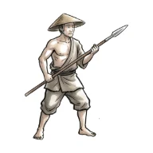 雑兵 | 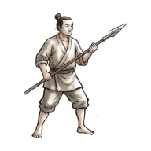 徒卒 | 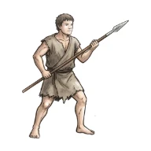 民兵 | u01b（足軽槍組／戈兵／重装歩兵） |
| u01b | 中級 | 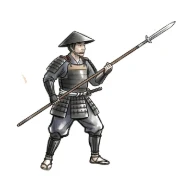 足軽槍組 | 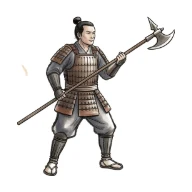 戈兵 | 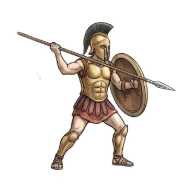 重装歩兵 | u01c（長柄足軽／戟兵／長槍密集兵） |
| u01c | 上級 | 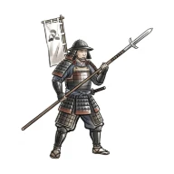 長柄足軽 | 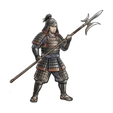 戟兵 | 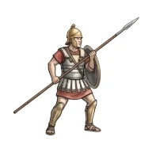 長槍密集兵 | — |

## 系統2：鼓舞（楽隊）

| 番号 | 格 | 日本版 | 中国版 | 西洋版 | 昇格先 |
|---|---|:-:|:-:|:-:|---|
| u02a | 下級 | 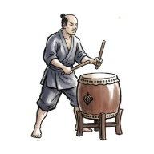 陣太鼓 | 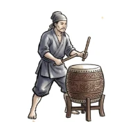 鼓手 | 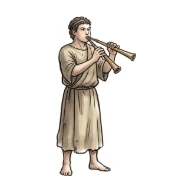 笛手 | u02b（法螺貝衆／金鼓隊／角笛手） |
| u02b | 中級 | 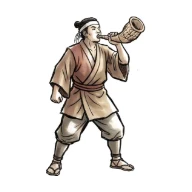 法螺貝衆 | 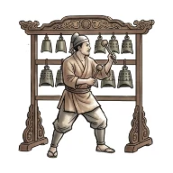 金鼓隊 | 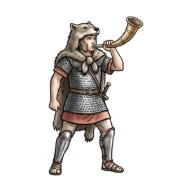 角笛手 | — |

## 系統3：小舟

| 番号 | 格 | 日本版 | 中国版 | 西洋版 | 昇格先 |
|---|---|:-:|:-:|:-:|---|
| u03a | 下級 | 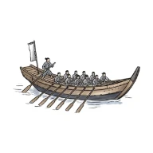 小早 | 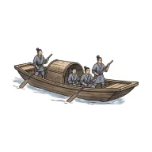 舟卒 | 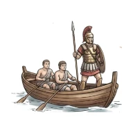 小舟隊 | u03b（関船／突冒／快速船） |
| u03b | 中級 | 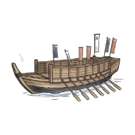 関船 | 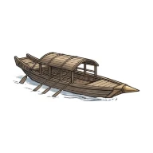 突冒 | 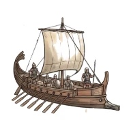 快速船 | — |

## 系統4：鉄砲・弩・投石

| 番号 | 格 | 日本版 | 中国版 | 西洋版 | 昇格先 |
|---|---|:-:|:-:|:-:|---|
| u04a | 下級 | 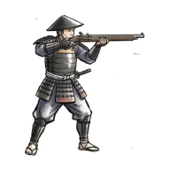 鉄砲足軽 | 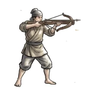 弩兵 | 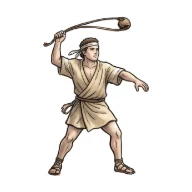 投石兵 | u04b（鉄砲組／強弩隊／精鋭投石兵） |
| u04b | 中級 | 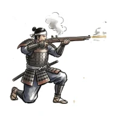 鉄砲組 | 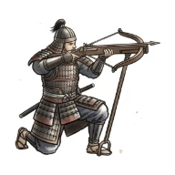 強弩隊 | 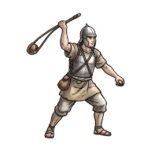 精鋭投石兵 | — |

## 系統5：忍び・刺客

| 番号 | 格 | 日本版 | 中国版 | 西洋版 | 昇格先 |
|---|---|:-:|:-:|:-:|---|
| u05a | 下級 | 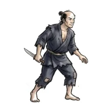 素破 | 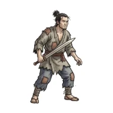 游卒 | 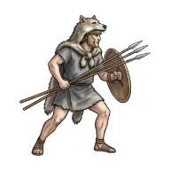 散兵 | u05b（透波／刺客／刺客） |
| u05b | 中級 | 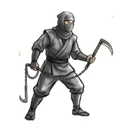 透波 | 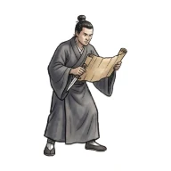 刺客 | 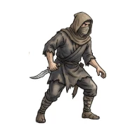 刺客 | u05c（伊賀者／死士／潜入兵） |
| u05c | 上級 | 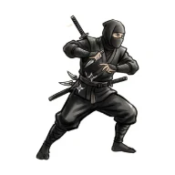 伊賀者 | 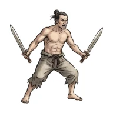 死士 | 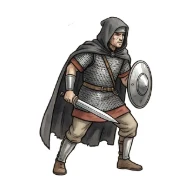 潜入兵 | — |

## 系統6：弓

| 番号 | 格 | 日本版 | 中国版 | 西洋版 | 昇格先 |
|---|---|:-:|:-:|:-:|---|
| u06a | 下級 | 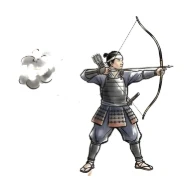 弓足軽 | 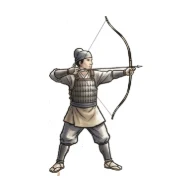 弓兵 | 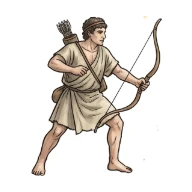 弓兵 | u06b（弓組／射士隊／重装弓兵） |
| u06b | 中級 | 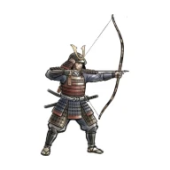 弓組 | 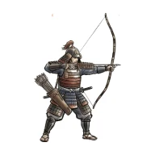 射士隊 | 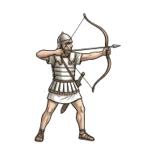 重装弓兵 | — |

## 系統7：軽騎兵

| 番号 | 格 | 日本版 | 中国版 | 西洋版 | 昇格先 |
|---|---|:-:|:-:|:-:|---|
| u07a | 下級 | 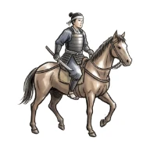 軽騎 | 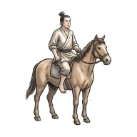 斥候騎 | 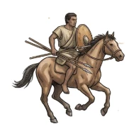 軽騎兵 | u07b（騎馬隊／騎兵／騎兵） |
| u07b | 中級 | 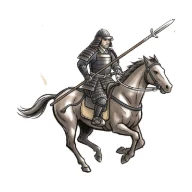 騎馬隊 | 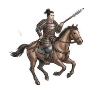 騎兵 | 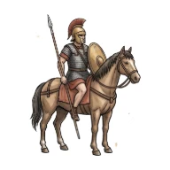 騎兵 | u07c（赤備え／胡騎／精鋭騎兵） |
| u07c | 上級 | 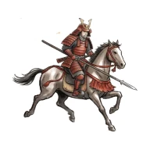 赤備え | 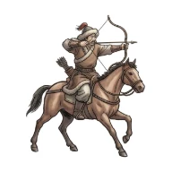 胡騎 |  精鋭騎兵 | — |

## 系統8：回復

| 番号 | 格 | 日本版 | 中国版 | 西洋版 | 昇格先 |
|---|---|:-:|:-:|:-:|---|
| u08a | 下級 |  金瘡医 |  医卒 |  衛生兵 | u08b（典薬衆／医官／騎乗医師） u08b2（陣僧衆／巫医隊／神官団） |
| u08b | 中級 |  典薬衆 |  医官 | （絵なし） 騎乗医師 | — |
| u08b2 | 中級 |  陣僧衆 |  巫医隊 | （絵なし） 神官団 | — |

## 系統9：盾

| 番号 | 格 | 日本版 | 中国版 | 西洋版 | 昇格先 |
|---|---|:-:|:-:|:-:|---|
| u09a | 下級 |  竹束衆 |  盾兵 | （絵なし） 盾持ち | u09b（盾衆／甲士／大盾兵） |
| u09b | 中級 |  盾衆 |  甲士 | （絵なし） 大盾兵 | u09c（鉄盾衆／虎賁／古参重装兵） |
| u09c | 上級 |  鉄盾衆 |  虎賁 | （絵なし） 古参重装兵 | — |

## 系統10：城攻め（工兵・攻城兵器）

| 番号 | 格 | 日本版 | 中国版 | 西洋版 | 昇格先 |
|---|---|:-:|:-:|:-:|---|
| u10a | 下級 |  黒鍬衆 |  輜重兵 | （絵なし） 工兵 | u10b（石火矢衆／投石車／弩砲） |
| u10b | 中級 |  石火矢衆 |  投石車 | （絵なし） 弩砲 | u10c（大筒衆／飛石車／投石機） |
| u10c | 上級 |  大筒衆 |  飛石車 | （絵なし） 投石機 | — |

## 系統11：大刀・斧

| 番号 | 格 | 日本版 | 中国版 | 西洋版 | 昇格先 |
|---|---|:-:|:-:|:-:|---|
| u11a | 下級 |  大太刀衆 |  勇士 | （絵なし） 長剣兵 | u11b（野太刀衆／大斧兵／大剣兵） |
| u11b | 中級 |  野太刀衆 |  大斧兵 | （絵なし） 大剣兵 | u11c（斬馬隊／鉞士／戦斧兵） |
| u11c | 上級 |  斬馬隊 |  鉞士 | （絵なし） 戦斧兵 | — |

## 系統12：山岳

| 番号 | 格 | 日本版 | 中国版 | 西洋版 | 昇格先 |
|---|---|:-:|:-:|:-:|---|
| u12a | 下級 |  山岳兵 |  山民兵 | （絵なし） 山岳兵 | u12b（山岳薬師／山医／山の薬師） u12b2（山岳精鋭／板楯兵／山岳精鋭） |
| u12b | 中級 |  山岳薬師 |  山医 | （絵なし） 山の薬師 | — |
| u12b2 | 中級 |  山岳精鋭 |  板楯兵 | （絵なし） 山岳精鋭 | — |

## 系統13：騎馬武者・戦車・重騎兵

| 番号 | 格 | 日本版 | 中国版 | 西洋版 | 昇格先 |
|---|---|:-:|:-:|:-:|---|
| u13a | 下級 |  騎馬武者 |  戦車 | （絵なし） 騎馬戦士 | u13b（母衣衆／重戦車／重騎兵） |
| u13b | 中級 |  母衣衆 |  重戦車 | （絵なし） 重騎兵 | u13c（旗本騎馬／駟馬戦車／親衛騎兵） |
| u13c | 上級 |  旗本騎馬 |  駟馬戦車 | （絵なし） 親衛騎兵 | — |

## 系統14：伏兵

| 番号 | 格 | 日本版 | 中国版 | 西洋版 | 昇格先 |
|---|---|:-:|:-:|:-:|---|
| u14a | 下級 |  野伏 |  伏兵 | （絵なし） 伏兵 | u14b（伏兵衆／林兵／森の伏兵） |
| u14b | 中級 |  伏兵衆 |  林兵 | （絵なし） 森の伏兵 | u14c（草の者／伏弩／精鋭伏兵） |
| u14c | 上級 |  草の者 |  伏弩 | （絵なし） 精鋭伏兵 | — |

## 系統15：火攻め

| 番号 | 格 | 日本版 | 中国版 | 西洋版 | 昇格先 |
|---|---|:-:|:-:|:-:|---|
| u15a | 下級 |  焙烙衆 |  火攻兵 | （絵なし） 火壺兵 | u15b（火矢衆／火牛／火矢兵） |
| u15b | 中級 |  火矢衆 |  火牛 | （絵なし） 火矢兵 | u15c（国崩し／火牛陣／火炎投射機） |
| u15c | 上級 |  国崩し |  火牛陣 | （絵なし） 火炎投射機 | — |

## 系統16：大船

| 番号 | 格 | 日本版 | 中国版 | 西洋版 | 昇格先 |
|---|---|:-:|:-:|:-:|---|
| u16a | 下級 |  安宅船 |  楼船 | （絵なし） 三段櫂船 | u16b（大安宅船／大翼／五段櫂船） |
| u16b | 中級 |  大安宅船 |  大翼 | （絵なし） 五段櫂船 | u16c（鉄甲船／余皇／大型櫂船） |
| u16c | 上級 |  鉄甲船 |  余皇 | （絵なし） 大型櫂船 | — |

## 系統17：指揮

| 番号 | 格 | 日本版 | 中国版 | 西洋版 | 昇格先 |
|---|---|:-:|:-:|:-:|---|
| u17a | 下級 |  使番衆 |  行人 | （絵なし） 伝令 | u17b（軍目付／軍正／軍団副官） |
| u17b | 中級 |  軍目付 |  軍正 | （絵なし） 軍団副官 | u17c（軍奉行／大司馬／軍団長） |
| u17c | 上級 |  軍奉行 |  大司馬 | （絵なし） 軍団長 | — |

## 系統18：調略

| 番号 | 格 | 日本版 | 中国版 | 西洋版 | 昇格先 |
|---|---|:-:|:-:|:-:|---|
| u18a | 下級 |  間者 |  間諜 | （絵なし） 密偵 | u18b（調略衆／説客／弁論家） |
| u18b | 中級 |  調略衆 |  説客 | （絵なし） 弁論家 | u18c（軍略衆／縦横家／策士） |
| u18c | 上級 |  軍略衆 |  縦横家 | （絵なし） 策士 | — |
